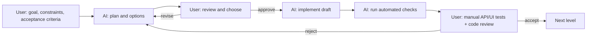

# AI-Assisted Development Log

**Project:** QueryMind-AI

**Document purpose:** This is a decision record, not a prompt dump. It shows how
the project was planned, built, reviewed, and verified with AI acting as a pair
programmer under continuous human direction. The user owned the requirements,
architecture, security posture, acceptance criteria, manual testing, and final
code verification. AI produced drafts; the user decided what was accepted. Every
phase started with a user-defined goal and ended with a user review.

---

## 1. Collaboration model

The user acted as product owner, architect, security reviewer, manual tester, and
final acceptance authority. AI acted as a fast drafting and implementation
partner. AI was never allowed to choose business definitions, security posture,
or acceptance criteria on its own. The user manually exercised the API and UI,
reviewed the code, and verified the results before accepting each level.

| Role       | Responsibility                                                                                                                                                                                                                           |
| ---------- | ---------------------------------------------------------------------------------------------------------------------------------------------------------------------------------------------------------------------------------------- |
| **User**   | Defined the problem, dataset questions, metric semantics, stack, security requirements, UX direction, branding, and acceptance criteria. Reviewed code, ran manual API/UI tests, verified evidence, and approved or rejected each level. |
| **AI**     | Proposed options, drafted code, generated tests, profiled the dataset, diagnosed failures, wrote documentation, and produced diagrams.                                                                                                   |
| **Shared** | Trade-off analysis and debugging; the user made the final call.                                                                                                                                                                          |

### AI tools used

| Tool         | How the user used it                                                                                                                                                                                               |
| ------------ | ------------------------------------------------------------------------------------------------------------------------------------------------------------------------------------------------------------------ |
| **Codex**    | First-pass implementation drafts: FastAPI endpoints, SQLAlchemy analytics, React workspace, tests, and documentation. The user supplied the requirements, reviewed the diffs, and accepted or rejected the output. |
| **OpenCode** | Iterative refactoring, debugging, documentation, test expansion, question-first filter precedence, and verification. The user directed each task and manually checked the result.                                  |

Groq-hosted models are a runtime feature, not a development tool. They
interpret questions only; they never write project code, write SQL, or compute
answer values.

### How AI was used

- The user wrote the brief, selected the stack, defined metric semantics,
  security posture, UX, branding, and acceptance criteria.
- AI proposed options and produced drafts; the user chose the direction.
- The user reviewed each level, ran the app, tested edge cases, and rejected work
  that did not match the brief.
- AI implemented the approved changes and reran automated checks.
- The user performed final code review and manual verification before acceptance.

### Working loop

The important pattern is that AI output was always treated as a draft. The user
reviewed the result and manually tested the running system at each level before
the next layer was built.

---

## 2. Initial plan

The project began with a user-defined brief and a fixed acceptance bar.

### User-defined brief

- Build a natural-language business-intelligence application for the supplied
  sales CSV.
- Answer the five required questions reliably.
- Use PostgreSQL/Supabase for data, FastAPI for the API, and React for the UI.
- Keep the language model optional and never let it write SQL or invent numbers.
- Return evidence: definitions, calculations, filters, supporting rows, and
  warnings.
- Provide automated tests and independent metric verification.
- Package the result as a polished, evaluator-ready project named
  **QueryMind-AI**.

### Constraints set by the user

| Constraint              | Consequence                                                                       |
| ----------------------- | --------------------------------------------------------------------------------- |
| Deterministic answers   | All figures come from SQL and Python, not from a model.                           |
| No raw SQL endpoint     | Only a validated `QueryPlan` may reach the analytics engine.                      |
| Least privilege         | Request-path queries use a read-only PostgreSQL role.                             |
| Graceful interpretation | Presets, an optional LLM, and a rule-based interpreter provide three paths.       |
| Evidence-first UX       | Every answer must expose its scope, definition, calculation, and supporting data. |
| Verifiable quality      | Tests must run without Supabase or an API key.                                    |

### Acceptance criteria

1. The five required questions work without an Groq key.
2. Invalid, ambiguous, and unsupported questions fail safely.
3. The runtime database role cannot write.
4. The test suite passes against an isolated database.
5. Independent CSV math matches the live database.
6. The frontend builds and lints cleanly.
7. The README and architecture document are understandable without reading the
   source.

---

## 3. Setup decisions

| Area           | User-led decision                                  | Why                                                          | Verification                                                                                                                                          |
| -------------- | -------------------------------------------------- | ------------------------------------------------------------ | ----------------------------------------------------------------------------------------------------------------------------------------------------- |
| Runtime        | Python 3.13 virtual environment                    | The system Python was too old for the selected stack.        | Tests and API run inside `backend/.venv`.                                                                                                             |
| Database       | Supabase PostgreSQL 17                             | Managed PostgreSQL with a production-like connection model.  | `/api/health` returns `"database": "ok"`.                                                                                                             |
| Connectivity   | Session Pooler                                     | The direct Supabase host is IPv6-only on many networks.      | Stable IPv4 connection using `aws-0-<region>.pooler.supabase.com`.                                                                                    |
| Roles          | Separate `sales_runtime` and administrative roles  | The request path must never be able to mutate data.          | `sales_runtime` has `default_transaction_read_only = on`, only `SELECT` on the table and view, and rejects INSERT, UPDATE, DELETE, TRUNCATE, and DDL. |
| Ingestion      | Idempotent CSV import                              | Re-running setup must not duplicate data.                    | 50 rows imported, 1 rejected, second run imports 0.                                                                                                   |
| Frontend       | React 19, Vite, TypeScript, Tailwind CSS, Recharts | Fast single-page workspace with typed contracts and charts.  | `npm run build` and `npm run lint` pass.                                                                                                              |
| Interpretation | Preset, optional Groq, rule-based fallback         | Reliability without making an API key mandatory.             | Fallback and preset paths are covered by tests.                                                                                                       |
| Quality        | SQLite test fixture plus live verification         | Fast isolated tests plus independent production-like checks. | 38 pytest tests and `verify_metrics.py`.                                                                                                              |

---

## 4. Level-by-level decisions

### Level 1 - Product scope

- **User direction:** Support totals, product and region rankings, monthly
  trends, and two-period comparisons; keep the UI focused on evidence rather
  than a generic chatbot.
- **AI contribution:** Proposed the feature list, endpoint shape, and response
  contract.
- **User-approved decision:** Ship a focused analytical workspace with presets
  and free-form questions.
- **Evidence:** `README.md`, `frontend/src/App.tsx`, `backend/app/api.py`.

### Level 2 - Data semantics

- **User direction:** Define revenue precisely and document every assumption.
- **AI contribution:** Profiled the CSV, identified the missing unit price, and
  drafted the data-quality rules.
- **User-approved decision:** Primary metric is **completed net revenue**:
  `quantity * unit_price - discount_amount` for completed transactions.
  Discounts are treated as transaction-level amounts. Returned rows are retained
  but excluded from completed metrics.
- **Evidence:** `DATA_PROFILE.md`, `backend/app/business_rules.py`.

### Level 3 - Security boundary

- **User direction:** Prevent SQL injection and arbitrary query execution by
  design, not by prompt wording.
- **AI contribution:** Drafted the `QueryPlan` schema, allowlists, and
  cross-field validators.
- **User-approved decision:** The model may only produce a schema-constrained
  plan. The analytics engine builds parameterized SQLAlchemy expressions from
  that plan.
- **Evidence:** `backend/app/query_planner.py`,
  `test_request_rejects_raw_sql_field`.

### Level 4 - Interpretation strategy

- **User direction:** Keep the required questions working without external
  dependencies, but allow a model to broaden coverage when configured.
- **AI contribution:** Implemented the preset path, Groq structured-output
  path, and rule-based fallback.
- **User-approved decision:** Resolution order is preset, then Groq, then
  rules. Ambiguity returns clarification; unsupported requests return an
  explanation.
- **Evidence:** `backend/app/ai_interpreter.py`,
  `backend/app/rule_based_interpreter.py`,
  `test_missing_Groq_key_uses_rule_based_fallback`.

### Level 5 - Analytics behavior

- **User direction:** Make edge cases honest: zero baselines, missing months,
  status filters, and non-completed transactions must not be silently guessed.
- **AI contribution:** Built the four operations and the shared completed-only
  logic.
- **User-approved decision:** Percentage change is `null` when the baseline is
  zero; missing months are absent rather than zero; status grouping disables the
  implicit completed filter.
- **Evidence:** `backend/tests/test_analytics.py`, `scripts/verify_metrics.py`.

### Level 6 - User experience

- **User direction:** Show the answer, the evidence, and the execution trace in
  one place; support filters, presets, charts, and CSV export.
- **AI contribution:** Drafted the React workspace, chart components, filter bar,
  and evidence panel.
- **User-approved decision:** The UI exposes the plan summary, confidence,
  timing, warnings, metric definitions, and supporting rows instead of hiding
  them.
- **Evidence:** `frontend/src/App.tsx`, `npm run build`, `npm run lint`.

### Level 7 - Reliability and abuse resistance

- **User direction:** Add practical production guardrails without overbuilding
  infrastructure.
- **AI contribution:** Implemented the sliding-window rate limiter, session TTL,
  request limits, and database timeouts.
- **User-approved decision:** 120 requests per minute per client,
  500-character questions, 25-row result cap, 15-minute sessions, and read-only
  database timeouts.
- **Evidence:** `backend/app/rate_limiter.py`, `backend/app/conversation.py`,
  `db/runtime_role.sql`, `test_rate_limiter_protection`.

### Level 8 - Presentation and branding

- **User direction:** Present the work as **QueryMind-AI** for users and
  evaluators, with clear diagrams, verified data, and no filler.
- **AI contribution:** Rewrote the README and architecture document, produced
  Mermaid diagrams, rebranded visible strings, and created a branded favicon.
- **User-approved decision:** Documentation leads with the problem, the
  guarantees, the architecture, and the evidence rather than a generic feature
  list.
- **Evidence:** `README.md`, `ARCHITECTURE.md`, `frontend/public/favicon.svg`.

---

## 5. Key decision records

### D1 - Structured QueryPlan instead of text-to-SQL

| Option                                   | Risk                                                                            |
| ---------------------------------------- | ------------------------------------------------------------------------------- |
| Let the model write SQL                  | SQL injection, hallucinated columns, unbounded scans, non-reproducible results. |
| Let the model call fixed functions only  | Safe but too narrow for natural-language variation.                             |
| **Chosen: schema-constrained QueryPlan** | The model handles language; deterministic code handles execution.               |

The user explicitly rejected a text-to-SQL design. AI proposed the closed-world
plan schema, and the user approved the trade-off: a finite vocabulary in exchange
for safety and reproducibility.

### D2 - Completed net revenue with reconciliation

The user defined the primary revenue metric and required returned transactions
to remain visible but excluded. AI proposed a reconciliation block showing gross
sales, discounts, net revenue, and excluded non-completed revenue. This makes the
number auditable instead of opaque.

### D3 - Read-only runtime role and Session Pooler

The user required a database role that cannot mutate data. AI implemented
separate administrative and runtime engines. `db/schema.sql` is administrative
setup DDL; `db/runtime_role.sql` sets `default_transaction_read_only = on`,
revokes all privileges, and grants only `SELECT` on `sales_transactions` and
`v_sales`. Each app session also runs `SET TRANSACTION READ ONLY`. Destructive
statements are rejected even if they reach PostgreSQL. The Session Pooler
decision came from debugging IPv4 connectivity.

### D4 - Three-path interpretation with graceful fallback

The user wanted the required questions to work without an API key. AI implemented
presets and a rule-based interpreter, then added the optional Groq path.
The fallback is a product feature, not an error state: the response reports which
path was used and how confident it was.

### D5 - Evidence-first answer builder

The user required every answer to explain itself. AI built a deterministic answer
builder that formats the result, metric definitions, filters, calculation,
warnings, suggestions, and chart metadata. No second LLM call is used, so a model
failure cannot change a number.

### D6 - Question-first scope precedence

The user required the question to remain the source of truth when the filter bar
is also populated. AI changed the override merge so filter-bar dates and
dimensions fill only gaps: a date range or dimension named in the question wins,
the ignored filter is reported in warnings, and a result with no date scope says
that it covers all available data.

---

## 6. Coordination and review gates

| Gate                 | User review focus                            | AI deliverable                      | Evidence                                  |
| -------------------- | -------------------------------------------- | ----------------------------------- | ----------------------------------------- |
| 1. Requirements      | Are the questions and scope correct?         | Feature list and API shape          | README scope                              |
| 2. Data profile      | Are the assumptions defensible?              | Column profile and rejection report | `DATA_PROFILE.md`                         |
| 3. Security          | Can the request path mutate data?            | Role SQL and plan schema            | `db/runtime_role.sql`, `query_planner.py` |
| 4. Analytics         | Are edge cases honest?                       | Engine and tests                    | `test_analytics.py`                       |
| 5. Interpretation    | Does it work without an API key?             | Presets, rules, LLM path            | `test_api.py`                             |
| 6. API contract      | Is the response useful and safe?             | Endpoints and answer builder        | `/docs`, `test_api.py`                    |
| 7. Frontend          | Is the evidence visible and usable?          | React workspace                     | `npm run build`, `npm run lint`           |
| 8. Verification      | Do independent calculations agree?           | Metric verification script          | `verify_metrics.py`                       |
| 9. Presentation      | Is the project understandable?               | README, architecture, favicon       | Documentation review                      |
| 10. Final acceptance | Do manual API/UI tests and code review pass? | Working app and reviewable diff     | User sign-off                             |

The user did not accept a phase merely because it ran. Each gate required a
visible artifact: a test result, a profile, a SQL role check, a build, or a
verified metric. The user also manually exercised the API/UI, reviewed the code,
and checked the evidence before sign-off.

---

## 7. Problems encountered and debugging

### Problem 1 - SQLAlchemy boolean clause error

- **Symptom:** Dynamic filters raised
  `TypeError: Boolean value of this clause is not defined`.
- **Root cause:** Python `or`/`and` attempted to coerce SQLAlchemy expressions
  into booleans.
- **Resolution:** Replaced Python logical operators with explicit `is None`
  checks and SQLAlchemy `or_()`, `and_()`, and list-based `.where(*conditions)`.
- **Verification:** Analytics tests cover combined filters.

### Problem 2 - FastAPI union return types

- **Symptom:** Endpoints returning either a dictionary or a `JSONResponse`
  triggered response-model warnings.
- **Root cause:** FastAPI tried to validate `JSONResponse` objects against an
  inferred response schema.
- **Resolution:** Added `response_model=None` to endpoints that may return
  structured error responses.
- **Verification:** Error-path tests pass.

### Problem 3 - Supabase direct connection timeout

- **Symptom:** The direct database host timed out.
- **Root cause:** The direct Supabase host is IPv6-only on many networks.
- **Resolution:** Switched to the Session Pooler and used the custom-role
  username format `<role>.<project-ref>`.
- **Verification:** Health check and live verification run successfully.

### Problem 4 - Discount amount semantics

- **Symptom:** A discount could be read as per-unit or per-transaction.
- **Root cause:** The CSV has one row per transaction and does not state the
  intended interpretation.
- **Resolution:** Adopted transaction-level discounts, documented the assumption,
  and rejected discounts greater than gross sales.
- **Verification:** `DATA_PROFILE.md` and business-rule tests.

### Problem 5 - Reasoning models and structured output

- **Symptom:** Some open-weight reasoning models returned empty or truncated
  structured output.
- **Root cause:** Hidden reasoning tokens consumed the output budget.
- **Resolution:** Set `temperature=0`, `max_tokens=2048`, and disabled reasoning
  for models that support that flag.
- **Verification:** Structured-output experiments and fallback tests.

### Problem 6 - Free-model availability

- **Symptom:** A free Groq endpoint returned upstream `429` responses.
- **Root cause:** The provider's shared free pool was rate-limited; the request
  itself was valid.
- **Resolution:** Kept the rule-based fallback as the guaranteed path and
  verified that the app returns a clear warning instead of failing.
- **Verification:** Fallback test and a direct API reproduction with a trivial
  prompt.

### Problem 7 - Filter bar silently replaced the question's scope

- **Symptom:** A question asking for June returned July when the filter bar was
  also set to July; the question text and the effective scope disagreed.
- **Root cause:** `_apply_overrides` replaced `plan.date_range` unconditionally
  and merged dimension filters without field-level precedence.
- **Resolution:** Made the question the source of truth. Filter-bar values now
  fill only missing scope, ignored values are reported in warnings, and
  compare-period questions keep their explicit periods.
- **Verification:** Six new API tests cover date precedence, dimension
  precedence, cross-field fill, compare-period date filters, missing date scope,
  and bare-month year assumptions. The user also manually tested "sales in June"
  with a July filter and confirmed that June won.

---

## 8. Verification evidence

| Check                     | Command                                                       | Result                                 |
| ------------------------- | ------------------------------------------------------------- | -------------------------------------- |
| Backend test suite        | `backend\.venv\Scripts\python.exe -m pytest backend\tests -q` | **38 passed**                          |
| Frontend production build | `npm run build`                                               | TypeScript and Vite build pass         |
| Frontend lint             | `npm run lint`                                                | No lint errors                         |
| Independent metrics       | `backend\.venv\Scripts\python.exe scripts\verify_metrics.py`  | CSV math matches live database         |
| Data profile              | `python -m app.data_profile`                                  | 51 rows, 50 importable, 1 rejected     |
| Read-only role            | Manual INSERT/UPDATE/DELETE/TRUNCATE/DDL check                | All writes rejected by `sales_runtime` |

### Manual testing and code verification by the user

The user did not accept automated green checks alone. The user:

- Ran the backend suite, frontend production build, frontend lint, independent
  metric verifier, and data profiler.
- Exercised the UI and `/api/ask` with the five required questions, ambiguous
  questions, unsupported metrics, invalid date ranges, and empty periods.
- Checked that answer text, evidence, filters, supporting rows, tables, and
  charts matched the effective plan.
- Tested question-first precedence: "sales in June" plus a July filter returned
  June and warned that July was ignored; "sales in East" plus a West filter
  returned East and warned that West was ignored.
- Connected with the `sales_runtime` role and attempted `INSERT`, `UPDATE`,
  `DELETE`, `TRUNCATE`, and `CREATE TABLE`; every write was rejected. The role
  has `default_transaction_read_only = on` and only `SELECT` privileges, and the
  app also runs each request in a read-only transaction.
- Reviewed the code diff, test changes, and documentation before accepting each
  level.

`db/schema.sql` is administrative setup DDL; it is not the read-only control.
Read-only enforcement lives in `db/runtime_role.sql` and
`backend/app/database.py`. The request path uses `DATABASE_URL`, never
`DATABASE_ADMIN_URL`.

### Verified completed revenue

| Metric                        |        Value |
| ----------------------------- | -----------: |
| Gross sales                   | 1,443,700.00 |
| Discounts                     |     4,500.00 |
| Net revenue                   | 1,439,200.00 |
| Transactions                  |           49 |
| Units sold                    |          633 |
| Average order value           |    29,371.43 |
| Excluded returned net revenue |    19,000.00 |

---

## 9. Responsibility split

| Workstream         | User                                                                                         | AI                                                                            |
| ------------------ | -------------------------------------------------------------------------------------------- | ----------------------------------------------------------------------------- |
| Problem definition | Wrote the brief, selected the required questions, and defined scope and acceptance criteria. | Reframed them as testable requirements and proposed options.                  |
| Metric semantics   | Chose completed net revenue, discount treatment, and excluded returns.                       | Profiled the CSV and drafted validation rules.                                |
| Architecture       | Chose the deterministic, read-only, question-first posture and approved module boundaries.   | Proposed the `QueryPlan` boundary, three-path interpreter, and trade-offs.    |
| Implementation     | Reviewed every layer, ran the app, manually tested API/UI behavior, and rejected mismatches. | Drafted FastAPI, SQLAlchemy, React, tests, and documentation.                 |
| Security           | Required least privilege and no raw SQL; manually verified destructive queries fail.         | Implemented roles, allowlists, parameterized queries, and read-only sessions. |
| Verification       | Ran manual checks, reviewed code and tests, and accepted the evidence.                       | Implemented and ran automated tests, builds, lint, and metric checks.         |
| Presentation       | Chose QueryMind-AI branding and evaluator-facing structure.                                  | Drafted README, architecture, diagrams, favicon, and this log.                |

---

## 10. What would be improved with another day

1. **Advanced text-to-SQL mode** - add an optional path for questions outside
   the `QueryPlan` vocabulary. A model would propose SQL, but the SQL would be
   parsed into an AST, checked against an allowlist of tables, columns, and
   operators, executed through the read-only role with row, scan, and time
   limits, and compared with the deterministic plan where both can answer.
2. **NLP-to-SQL verifier** - add an independent model or deterministic checker
   that restates the user's intent and verifies the SQL's tables, joins,
   filters, metric expressions, and date scope. A mismatch would trigger repair
   or refusal, never execution. The verifier would return its evidence and
   confidence.
3. **Advanced guardrails** - enforce AST allowlisting, no DDL/DML, read-only
   transactions, statement timeouts, row caps, `EXPLAIN` cost budgets,
   tenant/RLS rules, prompt-injection defenses, PII redaction, audit logging,
   and adversarial regression tests. Destructive or ambiguous SQL would be
   rejected before it reaches PostgreSQL.
4. **Evaluation harness** - add golden questions with expected rows, adversarial
   prompts, schema-drift tests, and SQL-equivalence checks so the text-to-SQL
   path cannot silently regress.

---

## 11. Technical rationale for evaluators

### Why this is agentic

The system perceives intent, plans a structured operation, invokes a
deterministic analytics tool, refuses ambiguous work, and grounds the final
answer in verified data. The model is bounded; the tool does the computation.

### Generative AI versus deterministic BI

Generative AI is probabilistic and useful for language. Business intelligence
requires reproducible numbers. QueryMind-AI confines the model to semantic
parsing and keeps all aggregation, grouping, and percentage math in SQL and
Python `Decimal`.

### Why text-to-SQL is not the default

The current path is deliberately narrower than text-to-SQL. A model that writes
SQL can produce plausible but wrong joins, filters, or metric expressions, and
it creates a destructive-query surface. QueryMind-AI keeps the model at the
`QueryPlan` layer and lets a parameterized engine build SQL.

A future text-to-SQL mode would be additive, not a replacement: AST validation,
an allowlisted schema, read-only execution, cost limits, and an independent NLP
verifier. The deterministic `QueryPlan` path remains the fallback and reference
implementation.

### Vectorless RAG

Traditional vector RAG retrieves text chunks by similarity. That cannot compute a
sum or a period comparison. QueryMind-AI injects schema metadata, allowed
dimensions, and canonical metric definitions as structured context. The model
selects fields; PostgreSQL performs the exact calculation. This avoids embedding
latency, vector database cost, and indexing drift.

### Framework choices

| Framework      | Role in QueryMind-AI                                                            | Production extension                                                  |
| -------------- | ------------------------------------------------------------------------------- | --------------------------------------------------------------------- |
| **LangChain**  | `ChatOpenAI` with `with_structured_output(QueryPlan)` and provider abstraction. | Persist sessions with `RunnableWithMessageHistory` and Redis.         |
| **Google ADK** | Not required for the current deterministic pipeline.                            | Expose analytics operations as ADK tools for Gemini function calling. |
| **Dify**       | Not required; the pipeline is intentionally code-first.                         | Map the five stages into a visual workflow with human review nodes.   |

---

## 12. Artifact map

| Artifact                        | Purpose                                                            |
| ------------------------------- | ------------------------------------------------------------------ |
| `README.md`                     | Product overview, setup, API, dataset profile, and verification.   |
| `ARCHITECTURE.md`               | System diagrams, request workflow, security model, and trade-offs. |
| `DATA_PROFILE.md`               | Column-level data profile and documented assumptions.              |
| `db/schema.sql`                 | Administrative schema, table, indexes, and view.                   |
| `db/runtime_role.sql`           | Read-only runtime role, grants, and timeouts.                      |
| `backend/app/query_planner.py`  | The validated contract between language and execution.             |
| `backend/app/analytics.py`      | Parameterized analytical engine.                                   |
| `backend/app/answer_builder.py` | Deterministic prose, evidence, and chart metadata.                 |
| `backend/tests/`                | 38-test regression suite.                                          |
| `scripts/verify_metrics.py`     | Independent CSV-to-database metric verification.                   |
