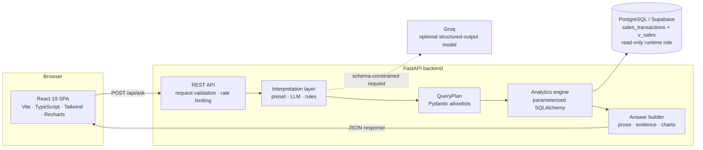
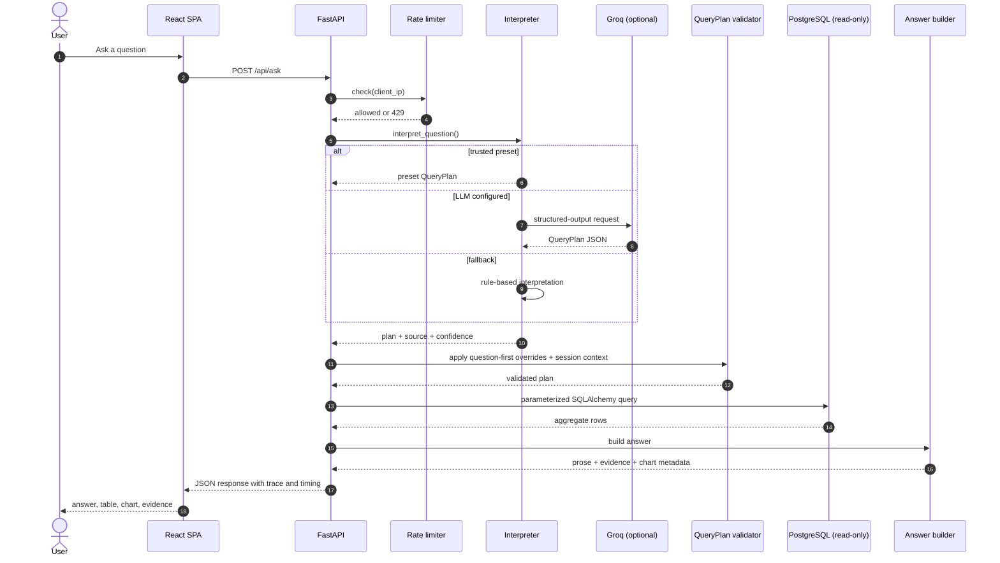
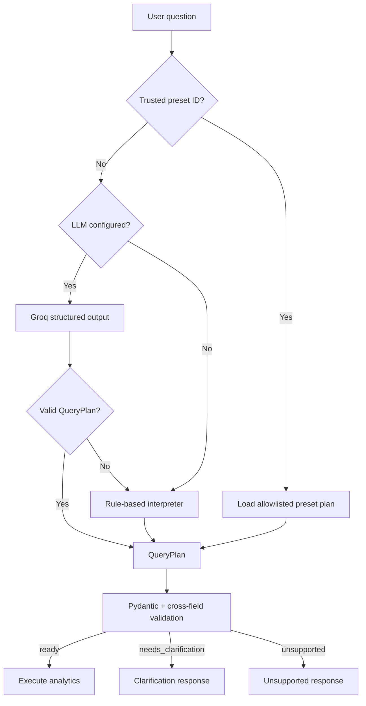
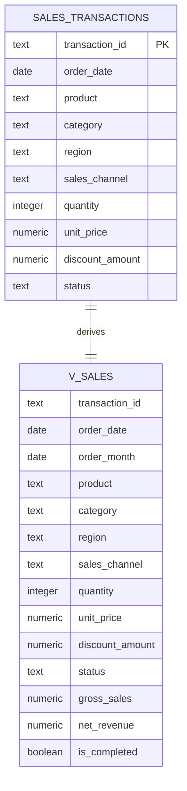
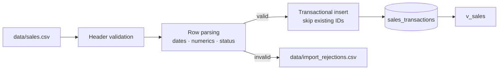
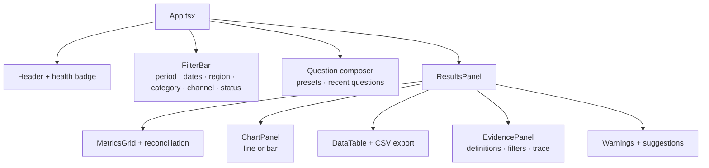
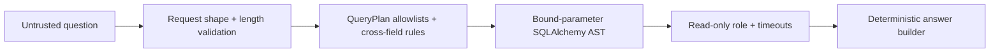
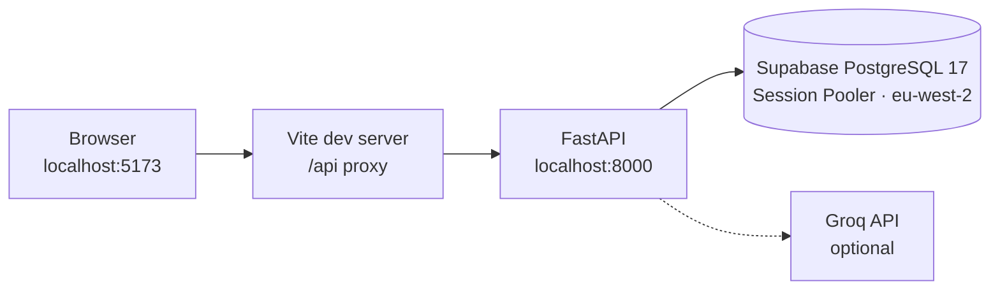
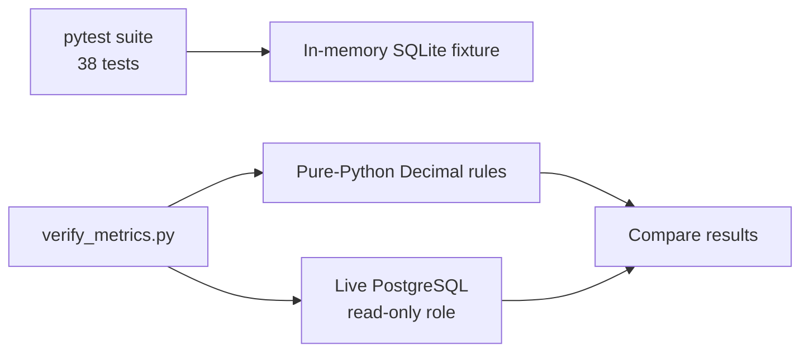
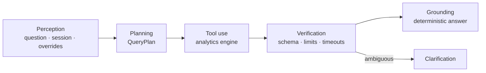

# QueryMind-AI Architecture

QueryMind-AI is a natural-language analytics system built around one rule:
**the language model interprets intent, but it never computes the answer.**

A question becomes a validated `QueryPlan`. The plan is executed by a
deterministic analytics engine against PostgreSQL through a read-only role, and
Python turns the result into prose, evidence, and chart metadata. The model is
optional, never sees database rows, and never supplies a number.

---

## Design principles

| Principle                       | Architectural consequence                                                                                |
| ------------------------------- | -------------------------------------------------------------------------------------------------------- |
| **Determinism over generation** | All figures come from SQL aggregates; prose is produced by deterministic Python templates.               |
| **A narrow contract**           | Only a validated `QueryPlan` can reach the analytics engine. Unknown fields and operations are rejected. |
| **Least privilege**             | Request-path queries use a dedicated read-only PostgreSQL role with timeouts and a connection limit.     |
| **Transparency**                | Every response carries its plan, filters, calculation, definitions, warnings, and execution trace.       |
| **Graceful degradation**        | Presets, an optional LLM, and a rule-based interpreter provide three independent interpretation paths.   |
| **Single responsibility**       | Interpretation, validation, execution, and presentation are separate modules with explicit boundaries.   |

## System context



The backend is stateless apart from two small in-memory stores: the rate limiter
and conversation sessions. All analytical state lives in PostgreSQL.

## Runtime components

| Component                                      | Responsibility                                                                                                                                                                           |
| ---------------------------------------------- | ---------------------------------------------------------------------------------------------------------------------------------------------------------------------------------------- |
| `app/main.py`                                  | Creates the FastAPI app, restricts CORS to `FRONTEND_URL`, runs a best-effort database readiness check, and logs whether the LLM is configured.                                          |
| `app/api.py`                                   | Defines request contracts, endpoints, overrides, rate limiting, response timing, plan summaries, and the five-stage execution trace.                                                     |
| `app/config.py`                                | Loads `.env` through `pydantic-settings`. Exposes database URLs, LLM settings, frontend origin, and currency code without logging secrets.                                               |
| `app/database.py`                              | Builds separate administrative and runtime engines. `runtime_session()` opens a read-only transaction with a statement timeout. Runtime code never falls back to the administrative URL. |
| `app/models.py`, `db/schema.sql`               | Define `sales_transactions`, indexes, and the `v_sales` view that centralizes `gross_sales`, `net_revenue`, `order_month`, and `is_completed`.                                           |
| `app/query_planner.py`                         | Defines the only structure that can reach the analytics engine, including allowlists and cross-field validation.                                                                         |
| `app/ai_interpreter.py`                        | Calls an Groq model through LangChain `ChatOpenAI` with structured output. Falls back safely when the model is unavailable or returns unusable output.                                   |
| `app/rule_based_interpreter.py`                | Deterministic, key-free interpretation for the required questions and common variants. Handles metrics, dimensions, filters, months, Top-N, and comparisons.                             |
| `app/analytics.py`                             | Builds parameterized SQLAlchemy expressions from validated plans and executes the four analytical operations.                                                                            |
| `app/answer_builder.py`                        | Converts results into deterministic prose, reconciliation, metric definitions, warnings, suggestions, and chart metadata. No second LLM call.                                            |
| `app/business_rules.py`                        | Single source of truth for CSV parsing, status normalization, metric formulas, labels, and definitions.                                                                                  |
| `app/conversation.py`                          | In-memory multi-turn context with a 15-minute sliding TTL and filter inheritance for refinement questions.                                                                               |
| `app/rate_limiter.py`                          | Thread-safe sliding-window limiter: 120 requests per minute per client IP.                                                                                                               |
| `app/import_csv.py`                            | Validates headers and rows, rejects unsafe records with reasons, imports transactionally, and skips existing IDs on rerun.                                                               |
| `app/data_profile.py`                          | Generates the dataset profile from the actual CSV.                                                                                                                                       |
| `frontend/src/App.tsx`                         | Single-page workspace: filters, question composer, presets, results, charts, evidence, trace, and export.                                                                                |
| `frontend/src/api.ts`, `frontend/src/types.ts` | Typed API client and response contract.                                                                                                                                                  |

## Request lifecycle



### Step by step

1. The browser submits a question, optional preset ID, optional filter/date
   overrides, and a session ID.
2. FastAPI validates the request shape and enforces the 500-character question
   limit and the per-client rate limit.
3. The interpreter selects one of three paths: trusted preset, Groq
   structured output, or rule-based interpretation.
4. Filter-bar overrides fill only scope the question leaves unspecified; a
   question-specified date range or dimension wins, and ignored overrides are
   reported in warnings. Conversation context may then add inherited filters.
5. Pydantic and cross-field rules validate the final plan.
6. The analytics engine builds a parameterized SQLAlchemy query and executes it
   inside a read-only transaction.
7. The answer builder formats the result without inventing values.
8. The API returns the answer, supporting data, calculation, definitions,
   warnings, plan summary, confidence, timing, and execution trace.
9. The session store records the turn for follow-up questions.

Ambiguous plans return `needs_clarification`; unsupported plans return
`unsupported` before any database work. Database failures return `503`,
unexpected failures return `500`, and rate-limit violations return `429`.

### Scope precedence

The question is the source of truth. If it already names a date range or a
dimension, the matching filter-bar value is ignored and the response reports it
in `warnings`. Filter-bar values fill only scope the question leaves
unspecified. If neither supplies a date, the answer covers all available data
and says so. `compare_periods` keeps its explicit periods and ignores date
filters.

## Interpretation workflow



### Interpretation sources

| Source   | When it is used                                                         | Confidence                         |
| -------- | ----------------------------------------------------------------------- | ---------------------------------- |
| `preset` | The request carries a server-recognized preset ID.                      | 1.00                               |
| `Groq`   | An API key and model are configured and the model returns a valid plan. | 0.92                               |
| `rules`  | No LLM is configured, or the LLM path fails.                            | 0.20–0.95 depending on specificity |

The LLM path uses LangChain `ChatOpenAI` pointed at
`https://Groq.ai/api/v1`, `temperature=0`, `max_tokens=2048`, a 30-second
timeout, and one retry. The system prompt defines business terms, allowed
operations, metrics, dimensions, filters, date rules, sorting, and limits. The
user question is treated as untrusted data, not as instructions.

## The QueryPlan contract

`QueryPlan` is the security and correctness boundary between interpretation and
execution. Unknown fields are forbidden.

| Field                    | Allowed values / rule                                                                         |
| ------------------------ | --------------------------------------------------------------------------------------------- |
| `status`                 | `ready`, `needs_clarification`, `unsupported`                                                 |
| `operation`              | `total`, `grouped_summary`, `time_series`, `compare_periods`                                  |
| `metrics`                | net revenue, gross sales, total discounts, transaction count, units sold, average order value |
| `group_by`               | product, category, region, sales channel, order month, status                                 |
| `filters`                | product, category, region, sales channel, status; `eq` or `in`                                |
| `date_range`             | Inclusive ISO start/end dates; start must not be after end                                    |
| `comparison`             | Exactly two explicit periods with labels and inclusive dates                                  |
| `sort_by`                | A selected metric or grouping dimension; `asc` or `desc`                                      |
| `limit`                  | Integer from 1 to 25                                                                          |
| `clarification_question` | Required when status is `needs_clarification`                                                 |
| `unsupported_reason`     | Required when status is `unsupported`                                                         |

Cross-field rules enforce operation semantics:

- `total` has no grouping and no comparison.
- `grouped_summary` requires at least one grouping dimension and no comparison.
- `time_series` groups by month automatically and forbids `group_by`.
- `compare_periods` requires two periods and forbids `date_range` and
  `group_by`.
- `sort_by.field` must be a selected metric or grouping dimension.

## Analytics engine

The engine builds SQLAlchemy expressions from validated plan fields. Dimension
columns are selected by attribute name from an allowlist; values are always
bound parameters, never interpolated SQL.

| Operation         | Behavior                                                                  |
| ----------------- | ------------------------------------------------------------------------- |
| `total`           | Aggregates the selected metrics over the filtered scope.                  |
| `grouped_summary` | Groups by one or more dimensions, sorts, and applies Top-N.               |
| `time_series`     | Groups chronologically by month.                                          |
| `compare_periods` | Computes two explicit periods and returns absolute and percentage change. |

Shared behavior lives in `_base_conditions()`:

- Metrics default to completed transactions.
- The implicit completed filter is skipped when `status` is filtered or grouped,
  so status comparisons remain honest.
- Missing months are absent from trends rather than silently filled with zero.
- Percentage change is `null` when the baseline is zero.
- Total net revenue uses `get_total_revenue()` to include a reconciliation of
  gross sales, discounts, net revenue, and excluded non-completed transactions.

## Data layer



- `sales_transactions` stores normalized rows with check constraints for
  non-negative quantity, price, and discount.
- Indexes cover date, product, category, region, channel, and status.
- `v_sales` centralizes derived expressions for inspection and consistency.
- `sales_runtime` has `default_transaction_read_only = on`, only `SELECT`
  privileges on `sales_transactions` and `v_sales`, no schema-creation rights,
  and statement, lock, and idle-transaction timeouts plus a connection limit.
  Destructive SQL is rejected by PostgreSQL even if it reaches the database.
- The administrative role is used only by schema setup and CSV ingestion.

## CSV ingestion workflow



The importer is idempotent and never overwrites the source file. A missing unit
price rejects the row; a missing discount defaults to zero with a warning; a
discount greater than gross sales is rejected; duplicate IDs keep the first
valid occurrence.

## Answer generation and evidence

`answer_builder.py` is deterministic and has no model dependency. It produces:

- Prose tailored to the operation and status.
- Key metrics and, for total revenue, a reconciliation.
- Supporting rows for the table and chart.
- Metric definitions, applied filters, date range, and calculation notes.
- Data-quality warnings, coverage notes, and suggested follow-ups.
- Chart metadata: a line chart for trends and a bar chart for grouped results.
- A five-stage execution trace for transparency.

Because the answer layer only formats engine output, a model failure cannot
change a number.

## Frontend architecture



The React app loads health and examples on mount, keeps a session ID for
follow-up questions, sends trusted filter values that fill gaps in the question, and
renders loading, empty, no-data, clarification, unsupported, and error states.
Charts use Recharts; styling uses Tailwind CSS 4.

## Conversation context

- Sessions are stored in memory with a 15-minute sliding TTL.
- A turn records the last question, operation, metrics, grouping, and filters.
- Refinement questions such as "now for North only" inherit previous filters
  that the new plan does not already specify.
- Inheritance is skipped for `compare_periods`, which carries its own explicit
  periods.
- Inherited filters are reported in the response warnings for transparency.

## Reliability and performance

| Control                     | Value                                 |
| --------------------------- | ------------------------------------- |
| LLM timeout                 | 30 seconds                            |
| LLM retries                 | 1                                     |
| Maximum result rows         | 25                                    |
| Maximum question length     | 500 characters                        |
| Rate limit                  | 120 requests per minute per client IP |
| Statement timeout           | 10 seconds                            |
| Lock timeout                | 5 seconds                             |
| Idle-in-transaction timeout | 15 seconds                            |
| Runtime connection limit    | 5                                     |
| Session TTL                 | 15 minutes                            |

The API returns server-side `response_time_ms` and logs operation, source, and
timing for each answered question.

## Security model



| Threat                    | Control                                                                                           |
| ------------------------- | ------------------------------------------------------------------------------------------------- |
| SQL injection             | No user text is interpolated into SQL; all values are bound parameters.                           |
| Arbitrary query execution | No endpoint accepts raw SQL or a raw plan; only `QueryPlan` reaches the engine.                   |
| Prompt injection          | The question is untrusted data; the model output is schema-validated and never executed directly. |
| Data mutation             | Request-path queries use a read-only role with `default_transaction_read_only`.                   |
| Credential exposure       | Errors do not include connection strings; secrets are loaded from `.env` and not logged.          |
| Abuse                     | Per-client sliding-window rate limiting and bounded question length.                              |
| Cross-origin access       | CORS is restricted to the exact configured frontend origin.                                       |
| Hallucinated numbers      | The model never sees rows and never produces answer values.                                       |

## Deployment topology



The runtime database connection uses the Session Pooler on IPv4-only networks.
The direct Supabase host is IPv6-only on many projects and is not used by the
default configuration.

## Testing strategy



- Unit and API tests use an isolated in-memory SQLite database with a known
  fixture.
- The monthly expression has a SQLite branch (`strftime`) and a PostgreSQL branch
  (`date_trunc`); both are semantically equivalent.
- The verification script compares source-CSV calculations with live database
  results through the read-only role.
- No normal test calls Groq or modifies Supabase.
- Frontend checks run `npm run build` and `npm run lint`.

## Agentic interpretation and vectorless grounding

QueryMind-AI behaves as a bounded analytical agent:



- **Perception** combines the question, previous session filters, and trusted UI
  overrides.
- **Planning** converts intent into a formal contract rather than free-form SQL.
- **Tool use** invokes the analytics engine as an isolated, verified tool.
- **Self-correction** returns clarification instead of guessing missing
  parameters.
- **Grounding** synthesizes prose strictly from tool output.

The system is deliberately **vectorless**. Embedding similarity cannot compute a
sum, an average, or a period comparison. Instead, the relational schema,
metric definitions, and business rules are injected as structured context; the
model selects the right dimensions and metrics, and SQL performs the exact
computation.

## Key decisions and trade-offs

| Decision                                      | Rationale                                                                         | Trade-off                                                          |
| --------------------------------------------- | --------------------------------------------------------------------------------- | ------------------------------------------------------------------ |
| Structured `QueryPlan` instead of text-to-SQL | Eliminates SQL injection and unbounded query risk while keeping the model useful. | The plan vocabulary is intentionally finite.                       |
| Deterministic answer builder                  | Guarantees that displayed numbers match the database.                             | Prose is templated rather than fully generative.                   |
| Read-only runtime role                        | Limits the blast radius of any application bug.                                   | Schema changes require the separate administrative connection.     |
| Rule-based fallback                           | Keeps the required questions working without external dependencies.               | Coverage is limited to common phrasings.                           |
| In-memory rate limiter and sessions           | Simple, dependency-free, and adequate for a single-process deployment.            | State is not shared across multiple backend replicas.              |
| No vector database                            | Relational aggregates require exact computation, not similarity search.           | The model relies on schema context rather than document retrieval. |

## Code map

```text
QueryMind-AI/
├── backend/app/          FastAPI, interpretation, validation, analytics, answers
├── backend/tests/        38 pytest tests with an isolated SQLite fixture
├── frontend/src/         React workspace, typed API client, response types
├── db/                   PostgreSQL schema, view, and read-only role
├── data/                 Source CSV and rejection report
├── scripts/              Metric verification and Groq connectivity check
├── README.md             Product overview, setup, API, and verification
├── ARCHITECTURE.md       This document
├── AI_USAGE.md           User-guided development and decision log
└── DATA_PROFILE.md       Column-level dataset profile
```
