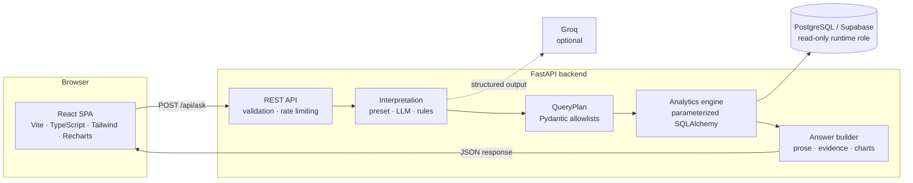

# QueryMind-AI

**Natural-language sales analytics with deterministic, evidence-backed answers.**

QueryMind-AI turns a plain-English sales question into a validated analytics
plan, executes parameterized SQL against PostgreSQL, and returns the answer with
the calculation, filters, supporting rows, and chart data behind every number.

The language model is an interpreter, not an analyst: it never writes SQL and
never supplies answer values. Every figure is computed by Python from the
database.

---

## Why QueryMind-AI

| Principle                 | How it is applied                                                                                      |
| ------------------------- | ------------------------------------------------------------------------------------------------------ |
| **Deterministic answers** | Python and SQL compute every number; the model only maps intent to a structured plan.                  |
| **Safe by construction**  | Pydantic allowlists, parameterized queries, and a read-only database role bound every request.         |
| **Transparent evidence**  | Each answer includes its definition, calculation, filters, supporting rows, and execution trace.       |
| **Graceful intelligence** | A rule-based interpreter handles the required questions; an optional Groq model broadens coverage.     |
| **Production-minded**     | Rate limiting, statement timeouts, session context, CSV export, and a 38-test suite ship with the app. |

## At a glance

| Layer          | Technology                                                                  |
| -------------- | --------------------------------------------------------------------------- |
| Frontend       | React 19, TypeScript, Vite 8, Tailwind CSS 4, Recharts                      |
| API            | FastAPI, Pydantic 2                                                         |
| Interpretation | LangChain + Groq (optional), deterministic rule-based fallback              |
| Analytics      | SQLAlchemy 2 with bound parameters                                          |
| Data           | PostgreSQL 17 / Supabase, dedicated read-only runtime role                  |
| Quality        | 38 pytest tests, independent metric verification, TypeScript build and lint |

## Feature highlights

- **Ask in natural language** — totals, rankings, monthly trends, and two-period
  comparisons.
- **Six metrics** — net revenue, gross sales, discounts, transaction count, units
  sold, and average order value.
- **Six dimensions** — product, category, region, sales channel, month, and
  status.
- **Flexible scope** — filters, date ranges, Top-N limits, and explicit period
  comparisons.
- **Validated query plans** — every plan passes operation rules, allowlists, date
  ordering, sorting checks, and a 25-row result cap.
- **Multi-turn context** — follow-up questions inherit relevant filters within a
  15-minute session.
- **Evidence panel** — metric definitions, calculation notes, filters, data
  coverage, warnings, and a five-stage agent execution trace.
- **Charts and export** — Recharts visualizations plus RFC 4180-compliant CSV
  export of the supporting data.
- **API protection** — a thread-safe sliding-window rate limiter (120 requests
  per minute per client).
- **Read-only analytics** — all request-path queries run through a restricted
  PostgreSQL role with statement, lock, and idle-transaction timeouts.

## Architecture



The model never receives database rows and never produces answer numbers. It
returns a schema-constrained `QueryPlan`; the deterministic engine does the rest.
See [`ARCHITECTURE.md`](ARCHITECTURE.md) for component details, sequence
diagrams, security controls, and the full request workflow.

## Documentation map

| Document                             | Purpose                                                                                                 |
| ------------------------------------ | ------------------------------------------------------------------------------------------------------- |
| [`README.md`](README.md)             | Product overview, setup, API reference, dataset profile, and verification.                              |
| [`ARCHITECTURE.md`](ARCHITECTURE.md) | System diagrams, request workflow, security model, and design trade-offs.                               |
| [`AI_USAGE.md`](AI_USAGE.md)         | User-guided development log: initial plan, setup, level-by-level decisions, coordination, and evidence. |
| [`DATA_PROFILE.md`](DATA_PROFILE.md) | Column-level dataset profile and documented assumptions.                                                |

## Tech stack

| Component        | Version       |
| ---------------- | ------------- |
| Python           | 3.13          |
| FastAPI          | 0.162.0       |
| Pydantic         | 2.14.1        |
| SQLAlchemy       | 2.1.6         |
| psycopg          | 3.3.6         |
| LangChain        | 1.4.7         |
| langchain-openai | 1.2.0         |
| PostgreSQL       | 17 (Supabase) |
| React            | 19.3.1        |
| Vite             | 8.3.5         |
| TypeScript       | 7.0.2         |
| Tailwind CSS     | 4.3.3         |
| Recharts         | 3.10.1        |

## Quick start

### Prerequisites

- Python 3.13
- Node.js 20.19+ (or 22.12+) and npm
- A Supabase project (or any PostgreSQL 17 database)

### 1. Install dependencies

```powershell
py -3.13 -m venv backend\.venv
backend\.venv\Scripts\python.exe -m pip install -r backend\requirements.txt

cd frontend
npm install
cd ..
```

### 2. Configure the environment

```powershell
Copy-Item .env.example .env
```

Fill in the values described in [Configuration](#configuration). The `.env` file
is gitignored and is never committed.

### 3. Prepare the database

Run `db/schema.sql`, then `db/runtime_role.sql`, in the Supabase SQL Editor.
Replace the placeholder password in `runtime_role.sql` before running it. See
[`db/README.md`](db/README.md) for the complete setup notes.

### 4. Import the dataset

```powershell
cd backend
.venv\Scripts\python.exe -m app.import_csv ..\data\sales.csv
```

The import is idempotent: 50 valid rows are inserted and the single invalid row
is written to `data/import_rejections.csv`. Re-running the command skips
existing transaction IDs.

### 5. Run the application

Terminal 1 — backend:

```powershell
cd backend
.venv\Scripts\python.exe -m uvicorn app.main:app --reload --port 8000
```

Terminal 2 — frontend:

```powershell
cd frontend
npm run dev
```

Open **http://localhost:5173**. Vite proxies `/api` to the backend on port 8000.
Interactive API documentation is available at **http://localhost:8000/docs**.

## Configuration

| Variable             | Required | Purpose                                                                        |
| -------------------- | -------- | ------------------------------------------------------------------------------ |
| `DATABASE_URL`       | Yes      | Runtime connection using the read-only `sales_runtime` role.                   |
| `DATABASE_ADMIN_URL` | Yes      | Administrative connection used only for schema setup and CSV import.           |
| `GROQ_API_KEY`       | Optional | Enables Groq-based interpretation for broader natural-language coverage.       |
| `GROQ_MODEL`         | Optional | Groq model ID; defaults to `openai/gpt-oss-120b`.                              |
| `GROQ_BASE_URL`      | Optional | OpenAI-compatible Groq endpoint; defaults to `https://api.groq.com/openai/v1`. |
| `FRONTEND_URL`       | Yes      | Exact browser origin allowed by CORS.                                          |
| `CURRENCY_CODE`      | Optional | ISO currency code for display; empty means plain numbers.                      |

```dotenv
DATABASE_URL=postgresql://sales_runtime.<project-ref>:<runtime-password>@<host>:5432/postgres
DATABASE_ADMIN_URL=postgresql://postgres.<project-ref>:<admin-password>@<host>:5432/postgres
GROQ_API_KEY=
GROQ_MODEL=openai/gpt-oss-120b
GROQ_BASE_URL=https://api.groq.com/openai/v1
FRONTEND_URL=http://localhost:5173
CURRENCY_CODE=
```

Supabase notes:

- Use the **Session Pooler** host (`aws-0-<region>.pooler.supabase.com`) on
  IPv4-only networks.
- Custom-role pooler usernames use the form `<role>.<project-ref>`.
- URL-encode an `@` in a password as `%40`.
- The runtime role is read-only and has no schema-creation rights. The backend
  never falls back to `DATABASE_ADMIN_URL` at request time.

## Dataset profile

The supplied dataset contains one row per transaction. All figures below were
produced from the actual CSV.

| Item                       |                    Value |
| -------------------------- | -----------------------: |
| Data rows                  |                       51 |
| Importable rows            |                       50 |
| Rejected rows              |                        1 |
| Date coverage (importable) | 2026-01-03 to 2026-06-25 |
| Products                   |                        7 |
| Categories                 |                        3 |
| Regions                    |                        4 |
| Sales channels             |                        2 |
| Currency                   |            Not specified |

### Verified completed revenue

| Metric                        |            Value |
| ----------------------------- | ---------------: |
| Gross sales                   |     1,443,700.00 |
| Discounts                     |         4,500.00 |
| **Net revenue**               | **1,439,200.00** |
| Transactions                  |               49 |
| Units sold                    |              633 |
| Average order value           |        29,371.43 |
| Excluded returned net revenue |        19,000.00 |

### Data-quality handling

- `TXN0051` is rejected because `Unit_price` is missing.
- A missing discount defaults to zero with a warning.
- A discount greater than gross sales is rejected.
- Zero-quantity rows are retained and flagged.
- Duplicate transaction IDs keep the first valid row.
- Status values are normalized to lowercase.
- Missing months are not invented as zero in monthly trends.

See [`DATA_PROFILE.md`](DATA_PROFILE.md) for the full column profile and
assumptions.

## Example questions

The five required questions are available as one-click presets:

1. What is the total revenue?
2. Which product generated the highest revenue?
3. What is the monthly revenue trend?
4. Which region generated the highest sales?
5. How did revenue change between January and February?

The interpreter also supports variants such as:

- What is revenue by category?
- Compare revenue by sales channel.
- Top 3 products in North by revenue.
- Total revenue in January 2026.
- Monthly revenue trend in 2026.
- How many transactions?
- What is the average order value?

Preset IDs are validated against a server-side allowlist; the browser cannot
submit an arbitrary query plan.

## API reference

| Method | Endpoint                    | Purpose                                                         |
| ------ | --------------------------- | --------------------------------------------------------------- |
| `GET`  | `/api/health`               | Service and database readiness, LLM configuration, currency.    |
| `GET`  | `/api/dataset/summary`      | Row count, date coverage, status counts, data-quality notes.    |
| `GET`  | `/api/examples`             | Preset IDs, labels, and questions.                              |
| `POST` | `/api/ask`                  | Interpret a question and return a deterministic answer.         |
| `POST` | `/api/export`               | Re-run the validated query and download supporting rows as CSV. |
| `GET`  | `/api/session/{session_id}` | Turn count, last question, last plan, and active filters.       |
| `GET`  | `/docs`                     | Interactive OpenAPI documentation.                              |

### `POST /api/ask`

```json
{
  "question": "Which product generated the highest revenue?",
  "preset_id": null,
  "overrides": {
    "date_range": { "start": "2026-01-01", "end": "2026-06-30" },
    "filters": [{ "field": "region", "operator": "eq", "values": ["North"] }]
  },
  "session_id": "sess_demo"
}
```

`question` is limited to 500 characters. `preset_id`, `overrides`, and
`session_id` are optional. The question is the source of truth: if it already
specifies a date range or dimension, the matching filter-bar value is ignored
and the response reports that in `warnings`. Filters fill only the scope the
question leaves unspecified.

Response statuses are `answered`, `needs_clarification`, `unsupported`, or
`error`. An answered response includes:

| Field                           | Meaning                                              |
| ------------------------------- | ---------------------------------------------------- |
| `answer`                        | Deterministic prose generated by Python.             |
| `metrics`                       | Aggregate metrics for total queries.                 |
| `supporting_data`               | Rows used by the table and chart.                    |
| `calculation`                   | How the result was calculated.                       |
| `filters_applied`, `date_range` | The exact analytical scope.                          |
| `visualization`                 | Chart type, axes, and title, or `null`.              |
| `warnings`, `suggestions`       | Data-quality notes and follow-up questions.          |
| `metric_definitions`            | Canonical business definitions.                      |
| `interpretation_source`         | `preset`, `groq`, or `rules`.                        |
| `interpretation_confidence`     | Confidence score for the selected path.              |
| `response_time_ms`              | Server-side processing time.                         |
| `query_plan_summary`            | The validated plan, safe for display.                |
| `agent_execution_trace`         | Five-stage transparency record.                      |
| `reconciliation`                | Gross sales, discounts, net revenue, and exclusions. |
| `periods`, `changes`            | Comparison details when applicable.                  |
| `has_data`                      | Whether the scope returned rows.                     |

## How interpretation works

1. **Preset path** — a trusted preset ID loads its allowlisted `QueryPlan`.
2. **LLM path** — when configured, a Groq model receives a system prompt
   describing the schema and business definitions, then returns structured
   output constrained to `QueryPlan`.
3. **Rule-based path** — a deterministic interpreter handles the required
   questions and common variants without any API key.
4. **Validation** — Pydantic and cross-field rules enforce allowed operations,
   metrics, dimensions, filters, dates, sorting, and limits.
5. **Execution** — the analytics engine builds parameterized SQLAlchemy queries
   and runs them through the read-only runtime session.
6. **Answering** — Python formats the answer, evidence, reconciliation, and chart
   metadata. No second LLM call is used.

The LLM is called with `temperature=0`, a 30-second timeout, and one retry.
Model output is treated as untrusted input.

## Trust and security

- No endpoint accepts raw SQL or an arbitrary query plan.
- User text is never interpolated into SQL; values are bound parameters.
- The LLM never sees database rows and never supplies answer numbers.
- Runtime queries use a dedicated read-only role with
  `default_transaction_read_only = on`, only `SELECT` privileges, per-session
  read-only transactions, timeouts, and a connection limit. Destructive SQL is
  rejected by PostgreSQL.
- The administrative connection is used only for schema setup and ingestion.
- Error responses do not expose credentials or connection details.
- The API applies per-client rate limiting and a 500-character question limit.
- CORS is restricted to the configured frontend origin.

## Testing and verification

### Automated tests

```powershell
backend\.venv\Scripts\python.exe -m pytest backend\tests -q
```

**38 tests pass** against an isolated in-memory SQLite fixture. Coverage includes:

- CSV parsing, validation, idempotency, and duplicate rejection
- Independent `Decimal` totals and all four analytical operations
- Empty periods, zero baselines, and missing months
- Plan validation and raw-SQL rejection
- Presets, clarification, unsupported questions, and fallback behavior
- Question-first filter and date-range precedence
- Rate limiting, conversation context, and CSV export
- Response timing, plan summaries, and health checks

### Independent metric verification

```powershell
backend\.venv\Scripts\python.exe scripts\verify_metrics.py
```

The script parses the source CSV with the canonical Python rules and compares
the results with the live database through the read-only role.

### Frontend checks

```powershell
cd frontend
npm run build
npm run lint
```

## Project structure

```text
QueryMind-AI/
├── backend/
│   ├── app/
│   │   ├── main.py                 # FastAPI app, CORS, startup checks
│   │   ├── api.py                  # Endpoints and request contracts
│   │   ├── config.py               # Environment settings
│   │   ├── database.py             # Runtime and administrative engines
│   │   ├── models.py               # SQLAlchemy models
│   │   ├── query_planner.py        # QueryPlan schema and validation
│   │   ├── ai_interpreter.py       # Groq structured-output path
│   │   ├── rule_based_interpreter.py
│   │   ├── analytics.py            # Parameterized analytics engine
│   │   ├── answer_builder.py       # Deterministic prose and evidence
│   │   ├── business_rules.py       # Metric definitions and CSV rules
│   │   ├── conversation.py         # Multi-turn session context
│   │   ├── rate_limiter.py         # Sliding-window API protection
│   │   ├── import_csv.py           # Validated, idempotent ingestion
│   │   └── data_profile.py         # Dataset profiling utility
│   ├── tests/                      # 38 pytest tests
│   └── requirements.txt
├── frontend/
│   ├── src/
│   │   ├── App.tsx                 # Single-page analytical workspace
│   │   ├── api.ts                  # Typed API client
│   │   └── types.ts                # Response contract
│   └── package.json
├── db/
│   ├── schema.sql                  # Table, indexes, and v_sales view
│   ├── runtime_role.sql            # Read-only role and timeouts
│   └── README.md
├── data/
│   ├── sales.csv                   # Source dataset
│   └── import_rejections.csv       # Rejected-row report
├── scripts/
│   ├── verify_metrics.py           # CSV vs. database verification
│   └── test_Groq.py          # Groq connectivity check
├── AI_USAGE.md                     # User-guided development log
├── ARCHITECTURE.md
├── DATA_PROFILE.md
└── README.md
```

## Scope and boundaries

QueryMind-AI is a single-tenant analytical workspace. Authentication, persistent
history, and multi-user administration are outside the current scope.

The dataset does not contain cost, inventory, customer, or marketing-attribution
data, so profit, margin, forecasting, and customer-level analysis are
intentionally unsupported. Share-of-total is not part of the current operation
set. Currency display is opt-in through `CURRENCY_CODE`, and monthly trends show
only months with matching rows rather than assuming missing months are zero.

---

**QueryMind-AI** — ask the question. See the evidence.
